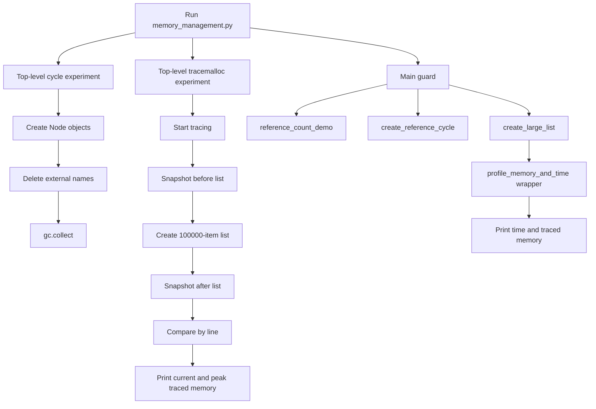

# Python Memory Management and Profiling

This repository is a learning project about how Python stores objects,
manages references, detects unreachable cycles, and measures memory and
execution time.

The main implementation for this topic is:

- [`week 2/Day_7/memory_management.py`](./week%202/Day_7/memory_management.py)

This README teaches the subject from the beginning and then explains the
actual implementation. It does not invent benchmark numbers: memory usage and
execution time depend on the Python version, operating system, machine load,
and allocator state.

## Table of contents

1. [Learning goals](#learning-goals)
2. [Python memory from zero](#python-memory-from-zero)
3. [Objects and references](#objects-and-references)
4. [Reference counting](#reference-counting)
5. [`sys.getrefcount()`](#sysgetrefcount)
6. [Reference cycles](#reference-cycles)
7. [Garbage collection and `gc`](#garbage-collection-and-gc)
8. [How `gc.collect()` works](#how-gccollect-works)
9. [`tracemalloc`](#tracemalloc)
10. [Snapshots and comparisons](#snapshots-and-comparisons)
11. [Current memory and peak memory](#current-memory-and-peak-memory)
12. [Memory leaks](#memory-leaks)
13. [Why backend engineers profile memory](#why-backend-engineers-profile-memory)
14. [Project architecture](#project-architecture)
15. [Actual implementation walkthrough](#actual-implementation-walkthrough)
16. [Experiments and observations](#experiments-and-observations)
17. [Custom profiler in depth](#custom-profiler-in-depth)
18. [Testing the project](#testing-the-project)
19. [Real-world applications](#real-world-applications)
20. [Interview preparation](#interview-preparation)
21. [Quick revision checklist](#quick-revision-checklist)

---

## Learning goals

After studying this guide, you should be able to:

- explain the difference between an object and a reference;
- describe Python's reference-counting behavior;
- explain why cycles need cyclic garbage collection;
- use `gc.collect()` deliberately during an experiment;
- use `sys.getrefcount()` without misinterpreting its extra reference;
- use `tracemalloc` snapshots to find Python allocation sites;
- distinguish current traced memory from peak traced memory;
- identify common causes of memory growth in backend programs;
- explain decorators, closures, `@wraps`, `*args`, and `**kwargs`;
- understand the custom `profile_memory_and_time` decorator; and
- design safer memory experiments without confusing traced memory with total
  process RAM.

---

# Python memory from zero

## What does “memory” mean?

When a Python program runs, it needs space to store:

- the instructions that make up the program;
- objects such as integers, strings, lists, dictionaries, and class
  instances;
- references that connect objects to one another;
- temporary values created during expressions; and
- interpreter data such as stack frames and module dictionaries.

The operating system gives the Python process a region of virtual memory.
Python's runtime requests memory from that region and uses its own allocator
to create and manage Python objects.

### A simple analogy

Imagine a storage room:

- an **object** is a box containing a value;
- a **reference** is a label pointing to a box;
- a variable is a convenient name attached to a label;
- deleting a variable removes one label, not necessarily the box; and
- garbage collection removes boxes that can no longer be reached.

The analogy is useful, but a Python object also has type information, metadata,
and links to other objects. A Python integer is not just the raw machine bytes
of a C integer; it is a Python object managed by the interpreter.

## CPython is the implementation discussed here

The exact details of reference counting and the cyclic garbage collector in
this guide describe **CPython**, the Python implementation most commonly
installed as `python3`. Other implementations, such as PyPy, can use
different memory-management strategies.

This distinction matters:

- Python the language defines behavior such as object lifetime and
  reachability at a high level.
- CPython commonly uses immediate reference counting plus a cyclic garbage
  collector.
- `sys.getrefcount()` and many `gc` details are CPython-oriented tools.

---

# Objects and references

## What is an object?

In Python, values are objects. An object has:

1. an identity: where that object exists during its lifetime;
2. a type: such as `int`, `list`, or `Node`; and
3. a value or state.

You can inspect these properties:

```python
number = 42

print(id(number))  # Identity token for this run
print(type(number))  # <class 'int'>
print(number)  # 42
```

The exact value returned by `id()` is implementation-dependent and should not
be treated as a permanent memory address.

## What is a reference?

A variable name refers to an object:

```python
numbers = [10, 20, 30]
another_name = numbers
```

There is one list object and two names that refer to it:

```text
numbers --------\
                 +----> [10, 20, 30]
another_name ---/
```

Mutating through either name changes the same list:

```python
another_name.append(40)
print(numbers)  # [10, 20, 30, 40]
```

Assignment does not copy the list. It creates or updates a reference.

If you need a separate list, copy it explicitly:

```python
numbers = [10, 20, 30]
copied_numbers = numbers.copy()
copied_numbers.append(40)

print(numbers)          # [10, 20, 30]
print(copied_numbers)   # [10, 20, 30, 40]
```

## What happens when a reference is deleted?

```python
data = [1, 2, 3]
another = data
del another
```

`del another` removes the name `another`. It does not delete the list while
`data` still refers to it.

```python
del data
```

Now no local name refers to the list. If no other reference exists, CPython
can usually reclaim it immediately through reference counting.

### Expected output

The statements above do not print anything. Their effect is a change in which
names point to the object.

### Real-world use

Understanding references helps prevent accidental sharing of mutable state in
web request handlers, caches, data pipelines, and class attributes.

### Interview question

**Question:** Does `b = a` copy a Python list?

**Answer:** No. It creates another reference to the same list. Use
`a.copy()`, `list(a)`, or an appropriate deep-copy strategy when a separate
object is required.

---

# Reference counting

## Basic explanation

Reference counting tracks how many active references point to an object. When
the count reaches zero, the object is unreachable through references and
CPython can usually deallocate it immediately.

```python
data = [1, 2, 3]  # One reference from the name data
alias = data      # A second reference
del alias         # Back to one reference
del data          # No user reference remains
```

The count includes references from many places, not just obvious variable
names. A list containing an object, a dictionary value, a stack frame, and
temporary interpreter operations can all contribute.

## Internal idea

Conceptually, a CPython object has a reference count in its object header:

```text
object header: type + reference count + other metadata
                         |
                         v
                    object value
```

When a new reference is created, CPython increments the count. When a
reference disappears, CPython decrements it. When it reaches zero, the
object's deallocation behavior runs.

This is an implementation model, not a promise that every Python
implementation has the same object header.

## Practical example

```python
import sys


data = [10, 20, 30]
print("Initial:", sys.getrefcount(data))

alias = data
print("After alias:", sys.getrefcount(data))

del alias
print("After deletion:", sys.getrefcount(data))
```

### Expected output

The exact numbers can vary, but the pattern should be:

```text
Initial: N
After alias: N + 1
After deletion: N
```

`sys.getrefcount()` itself temporarily adds a reference, so `N` is often one
greater than the count you might expect from the visible names.

## Strengths and limitations

Reference counting provides fast reclamation for most objects:

- an object does not need to wait for a later full collection when its count
  reaches zero;
- resources can often be released promptly; and
- the mechanism has ongoing increment/decrement overhead.

Reference counting alone cannot reclaim a cycle:

```text
a ---> object A ---> object B <--- b
       ^              |
       |______________|
```

Even after `a` and `b` are deleted, object A and object B still refer to each
other. Their counts are not zero.

### Real-world use

Reference counting explains why removing a large temporary list can reduce
its immediate object lifetime, but also why a retained reference in a global
cache can keep data alive for the entire process.

### Interview questions

**Question:** Is reference counting the same as garbage collection?

**Answer:** It is one memory-reclamation technique. In CPython, reference
counting handles most objects and cyclic GC handles unreachable reference
cycles.

**Question:** Does `del x` always free the object?

**Answer:** No. It removes one reference. The object can remain alive if other
references exist or if it is part of an unreachable cycle.

---

# `sys.getrefcount()`

## Basic explanation

`sys.getrefcount(value)` reports the reference count observed by CPython for a
value at the moment of the call.

```python
import sys

value = []
print(sys.getrefcount(value))
```

## Why is the result unexpectedly high?

The function receives the object as an argument. During the call, that
argument is an additional temporary reference:

```text
value name ----------------\
                            +----> list
getrefcount(value) argument/
```

Therefore the returned value is commonly one higher than the count visible in
the source code. Other temporary references or interpreter details can also
affect the number.

## Practical example

```python
import sys


items = []
print("Observed:", sys.getrefcount(items))

alias = items
print("Observed after alias:", sys.getrefcount(items))

del alias
print("Observed after deletion:", sys.getrefcount(items))
```

### Expected observation

The middle value should normally be one greater than the first, and the final
value should return to approximately the first value. Do not write a test that
requires exact absolute counts.

## When to use it

It is useful for:

- teaching references;
- investigating a small, isolated ownership experiment; and
- checking whether an expected alias was created or removed.

It is not a general memory-usage tool. A high reference count does not directly
tell you how many bytes the object consumes.

### Interview question

**Question:** Why should a test avoid asserting `sys.getrefcount(x) == 1`?

**Answer:** The call itself creates a temporary reference, and interpreter
implementation details can add references. Test relative changes or use a
purpose-built ownership design instead.

---

# Reference cycles

## Basic explanation

A reference cycle exists when objects refer to one another in a loop:

```python
class Node:
    pass


first = Node()
second = Node()
first.other = second
second.other = first
```

The graph is:

```text
first --> Node A --other--> Node B
          ^                  |
          |------other-------|
```

If the external names are deleted, the objects are no longer reachable from
the program's normal roots, but each object still has an internal reference.
Reference counting alone cannot bring either count to zero.

## Practical example

```python
import gc


class Node:
    pass


first = Node()
second = Node()
first.other = second
second.other = first

del first
del second

collected = gc.collect()
print("Objects collected:", collected)
```

### Expected output

The exact count depends on the Python runtime and what else is collectible.
The important observation is that `gc.collect()` is given an opportunity to
find and reclaim the unreachable cycle.

## Real-world causes

Cycles can appear in:

- parent/child object graphs;
- linked structures;
- objects that keep callbacks which refer back to their owner;
- caches with back-references; and
- framework registries.

Cycles are not automatically a bug. The issue is an unintended cycle that
keeps a large object graph alive longer than needed or makes cleanup timing
surprising.

### Interview question

**Question:** Why does a two-object cycle survive reference counting?

**Answer:** Each object keeps one internal reference to the other, so neither
reference count reaches zero when the external names are removed. A cyclic
collector must detect that the group is unreachable from outside the cycle.

---

# Garbage collection and `gc`

## Basic explanation

The `gc` module exposes CPython's cyclic garbage collector. It complements
reference counting by finding groups of objects that:

1. refer to one another;
2. are no longer reachable from live program roots; and
3. therefore cannot be used again.

```python
import gc

print(gc.isenabled())
gc.collect()
```

## Generational idea

CPython's cyclic collector organizes tracked objects into generations. Objects
that survive collections may be checked less frequently because long-lived
objects are statistically less likely to become garbage immediately.

The exact generation design and thresholds can change between Python versions.
The useful beginner model is:

- newly allocated tracked objects are considered young;
- surviving objects move toward older generations; and
- collections can inspect a generation and its references for unreachable
  cycles.

Not every Python value is tracked by cyclic GC. Simple atomic objects such as
many integers do not need cycle tracking. Container objects may be tracked
when their contents can participate in cycles.

## Useful `gc` functions

| Function | Purpose |
|---|---|
| `gc.collect()` | Request a collection and return the number of collected objects |
| `gc.isenabled()` | Check whether automatic cyclic GC is enabled |
| `gc.enable()` | Enable automatic cyclic GC |
| `gc.disable()` | Disable automatic cyclic GC |
| `gc.get_count()` | Inspect allocation counters used by the collector |
| `gc.get_threshold()` | Read automatic collection thresholds |
| `gc.set_debug()` | Enable diagnostic collection flags |

Use global GC settings carefully. Disabling collection in application code
without measurement can increase memory retention.

### Practical example

```python
import gc


class Node:
    pass


def create_cycle():
    left = Node()
    right = Node()
    left.right = right
    right.left = left


create_cycle()
print("Collected:", gc.collect())
```

### Expected output

The returned number may be zero or a larger runtime-dependent number. It is
not a stable “number of objects created by this function” because the
collector may also find other unreachable objects.

### Real-world use

Most applications should allow automatic collection. Explicit
`gc.collect()` can be useful:

- in a controlled diagnostic experiment;
- at a known safe boundary in a batch job; or
- when testing whether a suspected cycle becomes collectible.

It is not a universal performance fix.

### Interview questions

**Question:** Does `gc.collect()` free every unused object?

**Answer:** It primarily addresses collectable cyclic garbage. Reference-counted
objects may already have been reclaimed, and objects still reachable through a
global or stack reference cannot be collected.

**Question:** Should production code call it after every request?

**Answer:** Usually no. It can add latency and hide the real cause of memory
growth. Measure first and understand the lifecycle.

---

# How `gc.collect()` works

## Step-by-step model

When the program calls:

```python
collected = gc.collect()
```

the runtime requests a cyclic garbage-collection pass. Conceptually:

1. The collector identifies tracked container objects.
2. It examines references between them.
3. It estimates which references are internal to the candidate group.
4. It determines which group is unreachable from live roots.
5. It finalizes and reclaims objects that can safely be collected.
6. It returns a count reported by that collection operation.

This is a conceptual model. CPython's implementation has details around
tracking, finalizers, weak references, and safety rules.

## What `gc.collect()` does not do

It does not:

- make a live object disappear;
- remove a reference from a global cache;
- guarantee that the operating system immediately reduces the process's RSS;
- measure all process memory;
- fix a logical leak caused by an ever-growing data structure; or
- guarantee the same return count on every run.

### Interview question

**Question:** Why can process memory remain high after `gc.collect()`?

**Answer:** The objects may still be reachable, Python's allocator may retain
freed arenas for reuse, or the measurement may include memory outside the
collected objects. Object reclamation and returning pages to the OS are
different events.

---

# `tracemalloc`

## Basic explanation

`tracemalloc` is a standard-library module that traces memory allocations made
by Python code. It can show:

- current traced memory;
- peak traced memory;
- allocation traceback information; and
- differences between snapshots.

Start tracing before the operation you want to observe:

```python
import tracemalloc

tracemalloc.start()
data = [number for number in range(100_000)]
current, peak = tracemalloc.get_traced_memory()
print(current, peak)
tracemalloc.stop()
```

## What it measures

`tracemalloc` tracks Python memory allocations that it can trace. It is
excellent for answering questions such as:

- Which source lines allocated more Python memory?
- What changed between two points in a request?
- What allocation reached the highest traced peak?

It is not the same as total process RAM. It does not automatically represent
every native allocation made by extension modules, the interpreter, shared
libraries, thread stacks, or the operating system.

## Internal working

When tracing is enabled, Python records allocation information and traceback
metadata. This introduces overhead, so profiling should be enabled for the
measurement period rather than assumed to be free.

### Practical example

```python
import tracemalloc


tracemalloc.start()
before = tracemalloc.take_snapshot()

data = [number for number in range(100_000)]

after = tracemalloc.take_snapshot()
for statistic in after.compare_to(before, "lineno")[:3]:
    print(statistic)

tracemalloc.stop()
```

### Expected output

The output contains statistics with a file name, line number, size difference,
and allocation count difference. Exact sizes and line numbers depend on the
file and Python build.

### Real-world use

Use it to investigate a request handler that appears to retain Python
objects, compare before/after states in a batch step, or find the line that
creates a large temporary structure.

### Interview question

**Question:** Does `tracemalloc` report the complete RSS of a Python process?

**Answer:** No. It traces Python allocations, while RSS also includes native
allocations, interpreter structures, shared libraries, and allocator behavior.

---

# Snapshots and comparisons

## What is a snapshot?

A `tracemalloc` snapshot is a record of traced allocations at one moment:

```python
snapshot = tracemalloc.take_snapshot()
```

Take a baseline before the operation and a second snapshot afterward:

```python
before = tracemalloc.take_snapshot()
data = [number for number in range(100_000)]
after = tracemalloc.take_snapshot()
```

Compare them:

```python
statistics = after.compare_to(before, "lineno")
for statistic in statistics[:5]:
    print(statistic)
```

`"lineno"` groups differences by source file and line. Other grouping choices
can help answer different questions, such as grouping by file or traceback.

## How to interpret a statistic

A statistic can report:

- the current size attributed to a location;
- the difference from the earlier snapshot;
- the number of blocks; and
- the size and count differences.

A positive difference suggests more traced allocations remain associated with
that location at the later snapshot. It does not by itself prove a leak:
temporary data may still be alive at the second snapshot, or the allocator
may behave differently.

### Practical example

```python
import tracemalloc


tracemalloc.start()
before = tracemalloc.take_snapshot()

temporary = ["record"] * 10_000
after = tracemalloc.take_snapshot()

for item in after.compare_to(before, "lineno")[:5]:
    print(item)

del temporary
tracemalloc.stop()
```

### Expected output

The line creating `temporary` should appear among the largest differences.
The exact byte count is not predictable from the source alone.

### Real-world use

Snapshot comparison is useful for comparing:

- one API request before and after a feature;
- one batch iteration before and after processing;
- cache insertion before and after eviction; or
- repeated operations to see whether retained allocations grow.

### Interview question

**Question:** Does a positive snapshot difference prove a memory leak?

**Answer:** No. Repeat the operation, remove expected references, force a
controlled collection where appropriate, and compare retained growth over time.

---

# Current memory and peak memory

## `get_traced_memory()`

This call returns a pair:

```python
current, peak = tracemalloc.get_traced_memory()
```

- **Current memory:** traced bytes still allocated at that instant.
- **Peak memory:** highest traced allocation level since tracing started or the
  peak was reset.

Example:

```python
import tracemalloc


tracemalloc.start()
temporary = [0] * 100_000
current_after_create, peak_after_create = tracemalloc.get_traced_memory()

del temporary
current_after_delete, peak_after_delete = tracemalloc.get_traced_memory()

print(current_after_create, peak_after_create)
print(current_after_delete, peak_after_delete)
tracemalloc.stop()
```

### Expected observation

After deletion, current traced memory may decrease, but the peak usually
remains at least as high because it records the maximum observed level.

## Why peak matters

An application may allocate a large temporary object and release it before
the request ends. Current memory at the end can look normal while peak memory
reveals whether the request briefly required a dangerous amount of memory.

## `reset_peak()`

```python
tracemalloc.reset_peak()
```

This resets the recorded peak to the current traced amount. It is useful when
measuring one decorated function independently from earlier work.

It does not free memory or reset current allocations. It only changes the
reference point for the peak measurement.

### Interview question

**Question:** Can current memory be lower than peak memory?

**Answer:** Yes. A temporary allocation can raise the peak and then be
released, leaving a lower current traced amount.

---

# Memory leaks

## Basic explanation

A memory leak is memory that a program no longer needs but continues to retain,
so it cannot be reclaimed. In a garbage-collected language, a common leak is
not “forgot to call free”; it is “accidentally kept a reachable reference.”

## Common Python causes

### 1. Growing global collections

```python
requests_seen = []


def handle_request(request):
    requests_seen.append(request)
```

If the list is never bounded or cleared, every request remains reachable.

### 2. Unbounded caches

A cache without an eviction policy grows with every distinct key. Use a
maximum size, expiration, or an external cache with a policy.

### 3. Long-lived callbacks

A scheduler or event loop may retain a callback. If the callback closes over a
large object, the object stays alive too.

### 4. Accidental closures

```python
def make_handler(large_data):
    def handler():
        return len(large_data)

    return handler
```

The returned function retains `large_data` through its closure.

### 5. Reference cycles

Cycles are normally handled by cyclic GC, but finalizers, external resources,
or disabled collection can make lifecycle behavior more complicated.

### 6. Native extension allocations

An extension can allocate memory outside the Python allocator. A
`tracemalloc` result may not show the full growth.

## How to investigate suspected growth

1. Define what “growth” means: Python traced bytes, RSS, object count, or
   latency.
2. Reproduce the same operation repeatedly.
3. Take snapshots before and after comparable iterations.
4. Inspect the largest positive differences.
5. Check references, globals, caches, queues, callbacks, and task objects.
6. Use object-specific tools when needed.
7. Confirm that the retained data is unintended.

### Interview question

**Question:** Can a program have a memory leak even with garbage collection?

**Answer:** Yes. Garbage collection cannot reclaim objects that remain
reachable through a global list, cache, callback, queue, or other reference.

---

# Why memory profiling matters in backend applications

Backend services often run for hours or months. A small per-request retention
can become a large production failure:

```text
small retained object per request
        x thousands of requests
        x long process lifetime
        = increasing memory pressure
```

Memory profiling helps engineers:

- prevent worker restarts and out-of-memory kills;
- choose safe batch sizes;
- bound caches;
- detect request-specific retention;
- understand temporary peak usage;
- compare implementations before deployment; and
- distinguish a Python allocation issue from native or operating-system memory.

For a web service, measure representative traffic. A synthetic list allocation
is useful for learning, but it does not model every framework, database
driver, serialization library, or request lifecycle.

---

# Project architecture

## What this project does

The Day 7 implementation demonstrates three related areas:

1. **Reference behavior:** it observes reference counts before and after an
   alias is created and removed.
2. **Cyclic collection:** it creates two `Node` objects that refer to each
   other, deletes external names, and requests `gc.collect()`.
3. **Allocation profiling:** it uses `tracemalloc` snapshots to inspect a
   list allocation and defines a decorator that measures execution time and
   traced memory around a function.

## Why it was built

The project connects Python language behavior with backend engineering:

- references explain object lifetime;
- cycles explain why a second collector exists;
- snapshots explain how to locate allocation sites; and
- a decorator shows how profiling can be added without rewriting the target
  function.

## Modules used

| Module | Role in the implementation |
|---|---|
| `gc` | Requests cyclic garbage collection |
| `tracemalloc` | Tracks Python allocations and snapshots |
| `sys` | Provides `getrefcount()` |
| `time` | Provides `perf_counter()` for elapsed timing |
| `functools.wraps` | Preserves decorated function metadata |

All imports are from the Python standard library.

## Architecture diagram



## Execution flow

When the file is run directly:

1. The first cycle experiment runs immediately during module execution.
2. The first `tracemalloc` snapshot experiment runs immediately.
3. Function and decorator definitions are created.
4. The `__main__` guard calls `reference_count_demo()`.
5. It calls `create_reference_cycle()` again.
6. It prints a profiler heading.
7. The decorated `create_large_list()` runs through `wrapper()`.
8. The result is returned and its length is printed.

The first two experiments are top-level statements, so they also run if this
file is imported. The `__main__` section runs only when the file is executed
directly.

---

# Actual implementation walkthrough

The following sections describe the actual source file. Function names that
do not exist in the source are called out explicitly rather than invented.

## Module comments

The file begins with comments describing a reference-cycle experiment and
listing its intended steps. Comments are for readers; Python does not execute
them.

## `import gc`

```python
import gc
```

This imports CPython's cyclic garbage-collection interface. Without it, the
later call to `gc.collect()` would raise `NameError`.

## `class Node`

```python
class Node:
    pass
```

- `class Node:` defines a custom class.
- `pass` means the class body has no additional methods or fields.
- Instances can still receive attributes dynamically, so
  `a.other = b` is valid.

If the class definition were removed, `Node()` would be undefined and the
cycle experiment could not create its objects.

## `create_reference_cycle()`

```python
def create_reference_cycle():
    a = Node()
    b = Node()
    a.other = b
    b.other = a

    print("Reference cycle created")
    del a
    del b
    print("External references deleted")
    collected = gc.collect()
    print("Objects collected:", collected)
```

### Line-by-line behavior

| Code | Explanation |
|---|---|
| `def create_reference_cycle():` | Defines a function with no arguments. The body does not run until called. |
| `a = Node()` | Creates the first `Node` instance and stores a local reference in `a`. |
| `b = Node()` | Creates the second instance and stores a local reference in `b`. |
| `a.other = b` | Adds an `other` attribute to the first node pointing to the second. |
| `b.other = a` | Adds the reverse link, completing the cycle. |
| `print(...)` | Shows that the two-way relationship has been created. |
| `del a` | Removes the local name `a`; the first object remains referenced by `b.other`. |
| `del b` | Removes the local name `b`; the objects still reference each other internally. |
| `print(...)` | Shows that external local names have been removed. |
| `collected = gc.collect()` | Requests cyclic collection and stores its runtime-dependent count. |
| `print(...)` | Displays the returned count. |

### Inputs and outputs

- Inputs: none.
- Direct return value: `None`; the function prints instead of returning data.
- Side effects: creates temporary objects and requests collection.

### Expected output

The stable text is:

```text
Reference cycle created
External references deleted
Objects collected: <runtime-dependent integer>
```

The function is called once at top level and once under the main guard, so
those messages appear twice when the file is executed directly.

## Important naming note: `garbage_collection_demo()`

The requested name `garbage_collection_demo()` does **not** exist in the
actual source. Its behavior is represented by `create_reference_cycle()`,
which creates a cycle and calls `gc.collect()`. This README uses the actual
function name to keep the documentation faithful to the implementation.

## Top-level `tracemalloc` experiment

```python
import tracemalloc
tracemalloc.start()
before = tracemalloc.take_snapshot()
data = [i for i in range(100000)]
after = tracemalloc.take_snapshot()
print("Memory comparison:")
stats = after.compare_to(before, "lineno")
for stat in stats[:5]:
    print(stat)
current, peak = tracemalloc.get_traced_memory()
print("Current memory:", current)
print("Peak memory:", peak)
tracemalloc.stop()
```

### Line-by-line behavior

| Code | Explanation |
|---|---|
| `import tracemalloc` | Imports Python allocation tracing. |
| `tracemalloc.start()` | Begins tracing before the list is created. Removing it prevents the intended tracing data. |
| `before = tracemalloc.take_snapshot()` | Records the baseline allocation state. |
| `data = [i for i in range(100000)]` | Creates a list containing integers from 0 through 99,999. The list comprehension is eager. |
| `after = tracemalloc.take_snapshot()` | Records the later state after allocation. |
| `print("Memory comparison:")` | Prints a heading. |
| `stats = after.compare_to(before, "lineno")` | Calculates allocation differences grouped by source line. |
| `for stat in stats[:5]:` | Selects at most the five largest statistics and loops over them. |
| `print(stat)` | Displays each `StatisticDiff` in a human-readable form. |
| `current, peak = ...` | Uses tuple unpacking to receive the two memory measurements. |
| `print(...)` | Displays current traced bytes and the highest traced peak. |
| `tracemalloc.stop()` | Stops tracing. It does not delete `data`. |

The variable `data` remains referenced until the module finishes or the name
is deleted. Stopping tracing does not release the list.

## Important naming note: `memory_snapshot_demo()`

The source does not define a function named `memory_snapshot_demo()`. The
snapshot experiment is a top-level code block. Conceptually, it performs the
requested “memory snapshot demo,” but it is not callable as a function.

If it were later refactored into a function, the behavior should remain:
start tracing, take a baseline, perform the allocation, take a second
snapshot, compare, print, and stop tracing in a `finally` block.

## Repeated imports and top-level behavior

Because the reference-cycle and snapshot experiments are outside any
function, they run when the module is imported:

```python
import week_2.Day_7.memory_management
```

The repository path contains a space and is not currently arranged as a
standard importable package, but the Python rule is the same: top-level code
runs during import. The main guard prevents only the later `main` sequence
from running on import.

For reusable production modules, moving experiments into functions and using a
main guard consistently would reduce import side effects. The source is not
modified here because the requested task is documentation.

## `reference_count_demo()`

Before this function, the source imports the modules it needs for the second
part of the file:

```python
import gc
import sys
import time
import tracemalloc
from functools import wraps
```

The second `import gc` and `import tracemalloc` are harmless repeated imports:
Python reuses the already-loaded module. `sys` provides
`getrefcount()`, `time` provides `perf_counter()`, and `wraps` preserves
decorated-function metadata. Removing an import would make the first later use
of its name fail with `NameError`.

```python
def reference_count_demo():
    data = [10, 20, 30]
    print("\n--- REFERENCE COUNTING ---")
    print("Initial:", sys.getrefcount(data))
    another = data
    print("After another reference:", sys.getrefcount(data))
    del another
    print("After deleting reference:", sys.getrefcount(data))
```

### Line-by-line behavior

| Code | Explanation |
|---|---|
| `def reference_count_demo():` | Defines a no-argument demonstration function. |
| `data = [10, 20, 30]` | Creates a list and binds the local name `data` to it. |
| `print("\n--- REFERENCE COUNTING ---")` | Prints a blank line followed by a heading. |
| `sys.getrefcount(data)` | Observes the list's CPython reference count, including the temporary call reference. |
| `another = data` | Creates a second local reference to the same list. It does not copy the list. |
| `print(...)` | Shows the expected relative increase. |
| `del another` | Removes the second reference. |
| final `getrefcount` | Shows the count returning approximately to the initial level. |

### Inputs and outputs

- Inputs: none.
- Return value: `None`.
- Output: three reference-count observations.

### Expected pattern

```text
--- REFERENCE COUNTING ---
Initial: N
After another reference: N + 1
After deleting reference: N
```

Absolute values can differ. The implementation correctly demonstrates the
relative change, not a universal fixed count.

## `profile_memory_and_time(func)`

```python
def profile_memory_and_time(func):
    @wraps(func)
    def wrapper(*args, **kwargs):
        already_tracing = tracemalloc.is_tracing()
        if not already_tracing:
            tracemalloc.start()
        tracemalloc.reset_peak()
        before_memory, _ = tracemalloc.get_traced_memory()
        start_time = time.perf_counter()
        try:
            result = func(*args, **kwargs)
        finally:
            end_time = time.perf_counter()
            after_memory, peak_memory = tracemalloc.get_traced_memory()
            print(f"\nFunction: {func.__name__}")
            print(f"Execution time: {end_time - start_time:.6f} seconds")
            print(f"Current memory change: {after_memory - before_memory} bytes")
            print(f"Peak traced memory: {peak_memory} bytes")
            if not already_tracing:
                tracemalloc.stop()

        return result
    return wrapper
```

This function is a decorator factory in the broad sense that it receives a
function and returns a wrapper. It is not a decorator factory with
configuration arguments such as `@profile(limit=...)`; it is used directly as
`@profile_memory_and_time`.

### Decorators and closures first

A decorator receives a function and returns a replacement callable:

```python
def decorator(func):
    def wrapper(*args, **kwargs):
        return func(*args, **kwargs)

    return wrapper
```

The wrapper is a **closure** because it remembers `func` from the enclosing
`decorator` call even after the outer function has returned.

This syntax:

```python
@profile_memory_and_time
def create_large_list():
    ...
```

is equivalent to:

```python
def create_large_list():
    ...


create_large_list = profile_memory_and_time(create_large_list)
```

### Line-by-line behavior

| Code | Explanation |
|---|---|
| `def profile_memory_and_time(func):` | Receives the original function and begins constructing a decorated version. |
| `@wraps(func)` | Applies `functools.wraps` to preserve metadata such as `__name__` and `__doc__`. |
| `def wrapper(*args, **kwargs):` | Defines a wrapper accepting any positional and keyword arguments. |
| `already_tracing = tracemalloc.is_tracing()` | Records whether tracing was already enabled before this call. |
| `if not already_tracing:` | Avoids starting a second tracing session unnecessarily. |
| `tracemalloc.start()` | Starts tracing when this decorator owns the tracing session. |
| `tracemalloc.reset_peak()` | Sets the peak baseline to the current traced amount. |
| `before_memory, _ = ...` | Saves current traced bytes and intentionally ignores the old peak with `_`. |
| `start_time = time.perf_counter()` | Starts a high-resolution elapsed-time measurement. |
| `try:` | Guarantees that measurement and reporting are attempted even if the target raises. |
| `result = func(*args, **kwargs)` | Calls the original function with exactly the wrapper's arguments. |
| `finally:` | Enters cleanup/reporting whether the call succeeds or raises. |
| `end_time = time.perf_counter()` | Captures the end time. |
| `after_memory, peak_memory = ...` | Reads current and peak traced bytes. |
| `print(f"\nFunction: ...")` | Prints the original function name, preserved by `wraps`. |
| execution-time print | Reports elapsed seconds formatted to six decimal places. |
| current-memory print | Reports the difference between after and before current traced bytes. |
| peak-memory print | Reports the peak traced amount since `reset_peak()`. |
| conditional `stop()` | Stops tracing only if this wrapper started it. |
| `return result` | Returns the original function's value to the caller. |
| `return wrapper` | Returns the closure that replaces the original function. |

### What would happen if lines were removed?

| Removed behavior | Consequence |
|---|---|
| `@wraps(func)` | The decorated function would normally be named `wrapper`, and metadata would be less useful. |
| `*args, **kwargs` | Functions with arguments could fail when decorated. |
| tracing start | Memory calls may show zero or incomplete information. |
| `reset_peak()` | The reported peak could include allocations from earlier tracing work. |
| `perf_counter()` calls | Execution time could not be calculated. |
| `try/finally` | An exception could skip profiling output and tracing cleanup. |
| `return result` | The decorated call would return `None` instead of the original list. |
| conditional `stop()` | A wrapper could unexpectedly stop tracing owned by its caller. |

## `@wraps(func)`

`wraps` copies important metadata from the original function to the wrapper:

```python
@profile_memory_and_time
def create_large_list():
    ...

print(create_large_list.__name__)  # create_large_list
```

Without `@wraps`, the name would commonly be `wrapper`. `wraps` does not
change the execution behavior; it improves introspection, logging, debugging,
documentation, and framework integration.

## `*args` and `**kwargs`

```python
def wrapper(*args, **kwargs):
    return func(*args, **kwargs)
```

- `args` collects positional arguments into a tuple.
- `kwargs` collects keyword arguments into a dictionary.
- The `*` and `**` on the call unpack them back into the original function.

Example:

```python
@profile_memory_and_time
def combine(left, right=0):
    return left + right

combine(2, right=3)
```

The wrapper receives `(2,)` and `{"right": 3}`, then forwards both correctly.

## `time.perf_counter()`

`time.perf_counter()` is designed for measuring elapsed intervals:

```python
start = time.perf_counter()
# work
elapsed = time.perf_counter() - start
```

It should be used for durations rather than wall-clock timestamps. The
reported result includes Python execution, tracing overhead, scheduling
interruptions, and the target function's work.

## `tracemalloc.get_traced_memory()`

The function returns:

```python
(current_bytes, peak_bytes)
```

In the wrapper:

```python
before_memory, _ = tracemalloc.get_traced_memory()
...
after_memory, peak_memory = tracemalloc.get_traced_memory()
```

The current change is:

```python
after_memory - before_memory
```

This is not necessarily the total size of objects created by the target:
objects can be freed during the call, and allocations can exist before the
call.

## `try/finally`

The `finally` block runs when the target returns and also when it raises. This
is essential for reliable timing and for stopping tracing when the decorator
started it.

One subtle behavior remains: if `func` raises, the `finally` block prints
measurements, but the exception still propagates because the wrapper does not
catch or suppress it. The `return result` line is not reached in that case.

## Decorator limitations

The custom profiler is intentionally educational. It has limitations:

- It traces Python allocations, not complete process memory.
- It adds overhead that changes the measured timing.
- It prints rather than returning structured metrics.
- It does not measure CPU time separately from waiting or scheduling.
- It does not compare snapshots for the decorated call.
- It does not identify which source lines allocated the bytes.
- Concurrent calls can interleave printed output.
- A function's returned object can remain alive after the call, affecting
  current memory.
- If tracing was already active, the decorator leaves it active but includes
  other allocations occurring during the call.
- The reported “current memory change” can be negative.

For production observability, prefer a structured metrics interface and a
profiling strategy appropriate to the deployment environment.

## `create_large_list()`

```python
@profile_memory_and_time
def create_large_list():
    numbers = [i for i in range(100000)]
    return numbers
```

### Line-by-line behavior

- `@profile_memory_and_time` replaces the function with the profiling wrapper.
- `def create_large_list():` defines a no-argument function.
- The list comprehension eagerly creates integers from 0 through 99,999.
- `return numbers` returns the list, so it remains reachable through the
  caller's `result` variable after the wrapper finishes.

Its output is not a fixed number. The profiler prints a function name,
elapsed-time value, current traced-memory change, peak traced memory, and then
the main block prints:

```text
List length: 100000
```

The returned list is why the current memory after the function can still
include the allocation.

## Main guard and final execution

```python
if __name__ == "__main__":
    reference_count_demo()
    create_reference_cycle()
    print("\n--- CUSTOM PROFILER ---")
    result = create_large_list()
    print("List length:", len(result))
```

- The condition is true when the file is executed directly.
- `reference_count_demo()` runs the alias experiment.
- `create_reference_cycle()` runs the cycle experiment a second time.
- The heading separates profiler output.
- `create_large_list()` actually invokes the wrapper because decoration
  occurred when the function was defined.
- `len(result)` verifies that the returned list contains 100,000 items.

If the file is imported, this block does not run, although the earlier
top-level experiments still do.

---

# Experiments and expected observations

## 1. Reference count before and after an alias

The actual function performs:

1. create `[10, 20, 30]`;
2. observe its reference count;
3. bind `another = data`;
4. observe the increase;
5. delete `another`;
6. observe the decrease.

Expected result: the middle observation is approximately one higher.

## 2. Creating and deleting circular references

`create_reference_cycle()` creates two nodes and links them both ways. Deleting
`a` and `b` removes external local references, but the nodes retain internal
references until cyclic collection finds them.

Expected result: the function reports the cycle, reports deleted external
references, and prints a runtime-dependent collection count.

## 3. Running `gc.collect()`

The explicit call makes the experiment deterministic in intent: collection is
requested at that point. It does not guarantee a fixed count or prove that
every object from the function was collected.

## 4. Snapshots before and after list creation

The top-level experiment takes `before`, creates 100,000 integers, takes
`after`, and compares by line. The line containing the list comprehension
should be a major positive difference in the comparison.

Do not expect exactly 100,000 times a simple integer size: list capacity,
integer object representation, allocator behavior, and tracing metadata all
matter.

## 5. Comparing allocation statistics

```python
stats = after.compare_to(before, "lineno")
for stat in stats[:5]:
    print(stat)
```

The first five statistics are the largest differences according to the
snapshot comparison. The ordering and values depend on the complete run.

## 6. Comparing small and large lists

The comments suggest changing `100000` to `1000000` and `10000000`. This is a
useful experiment, but it can take significantly more time and memory. Run
large cases carefully:

```python
data = [i for i in range(1_000_000)]
```

Expected observation: larger inputs generally require more allocation and
often more time. The relationship need not be exactly linear because of
allocator behavior, system pressure, integer reuse, and measurement overhead.

## 7. Profiling execution time and memory

The decorated `create_large_list()` reports:

- elapsed time from two `perf_counter()` readings;
- current traced-memory difference; and
- peak traced memory after the peak reset.

The result list is returned to the caller, so the allocation remains
reachable at the end of the function. Output values must be recorded from the
machine on which the experiment runs; this README deliberately provides no
fabricated benchmark numbers.

---

# Testing the project

## Basic syntax check

From the repository root:

```bash
python3 -m py_compile "week 2/Day_7/memory_management.py"
```

This checks syntax and creates a bytecode cache in some environments. If the
repository ignores caches, that is normal; do not commit generated bytecode.

## Normal execution

```bash
python3 "week 2/Day_7/memory_management.py"
```

Expected categories of output:

1. cycle creation and collection;
2. snapshot statistics;
3. current and peak traced memory;
4. reference-counting observations;
5. the second cycle experiment;
6. profiler output; and
7. `List length: 100000`.

Exact numbers and statistic lines vary.

## Small allocation test

The current `create_large_list()` is fixed at 100,000 values. For a small
isolated test without changing the source, import the function carefully or
write a separate temporary experiment. Because top-level code currently runs
on import, direct execution is safer for beginners.

A small independent profiling example is:

```bash
python3 - <<'PY'
import time
import tracemalloc

tracemalloc.start()
start = time.perf_counter()
small = [number for number in range(10)]
elapsed = time.perf_counter() - start
current, peak = tracemalloc.get_traced_memory()
print(len(small), elapsed, current, peak)
tracemalloc.stop()
PY
```

Expected observation: the allocation and duration are much smaller than a
large list, but exact values are environment-dependent.

## Large allocation test

Run the source normally, then compare with a controlled experiment using one
million values. Watch available memory:

```bash
python3 - <<'PY'
import tracemalloc

tracemalloc.start()
large = [number for number in range(1_000_000)]
print("Length:", len(large))
print("Current and peak:", tracemalloc.get_traced_memory())
tracemalloc.stop()
PY
```

Do not jump immediately to tens of millions on a constrained machine.

## Circular-reference test

The source already performs this test twice when run directly. To isolate the
concept in a small script:

```bash
python3 - <<'PY'
import gc

class Node:
    pass

left = Node()
right = Node()
left.right = right
right.left = left
del left, right
print("Collected:", gc.collect())
PY
```

The count is runtime-dependent.

## Exception-handling test for the decorator

The current source decorates only a successful function. The decorator's
`finally` behavior can be tested independently:

```bash
python3 - <<'PY'
import time
import tracemalloc
from functools import wraps

def profile(func):
    @wraps(func)
    def wrapper(*args, **kwargs):
        tracemalloc.start()
        start = time.perf_counter()
        try:
            return func(*args, **kwargs)
        finally:
            print("finally ran:", time.perf_counter() >= start)
            tracemalloc.stop()
    return wrapper

@profile
def fails():
    raise ValueError("expected test error")

try:
    fails()
except ValueError as error:
    print("Exception propagated:", error)
PY
```

Expected behavior:

```text
finally ran: True
Exception propagated: expected test error
```

This confirms that cleanup/reporting runs while the original exception is not
silently swallowed.

## Test-case table

| Test | What to verify | Expected observation |
|---|---|---|
| Normal execution | Main flow completes | List length is 100000 |
| Small allocation | Smaller list uses less work | Lower, environment-dependent values |
| Large allocation | Scaling behavior | More time and traced allocation |
| Circular references | Cycle becomes collectible | `gc.collect()` is invoked |
| Exception handling | `finally` executes | Measurement runs and exception propagates |
| Reference alias | Alias changes count | Relative count increases then decreases |
| Snapshot comparison | Allocation site appears | List-comprehension line is among positive differences |

---

# Real-world applications

## FastAPI applications

In a FastAPI service, a request handler may create large JSON payloads,
database result lists, or temporary transformations. A profiling wrapper can
be applied during a diagnostic session:

```python
from fastapi import FastAPI

app = FastAPI()


@app.get("/diagnostic")
@profile_memory_and_time
def diagnostic_endpoint():
    return {"items": [1, 2, 3]}
```

Do not print profiling output for every production request without considering
latency, volume, privacy, and log cost. Prefer sampling and structured
metrics.

## Backend APIs

Memory profiling can reveal:

- response serialization retaining large objects;
- request-scoped data stored in module globals;
- a cache without a limit;
- ORM objects retained by a session; and
- queues that grow faster than workers consume them.

## Long-running Python processes

Workers, schedulers, and consumers amplify small retention errors. Compare
snapshots after repeated batches, not only after one function call.

## Caching systems

Every cached value has a lifecycle. Track:

- number of entries;
- approximate value size;
- eviction behavior;
- key cardinality; and
- whether keys accidentally include unbounded request data.

## Data-processing pipelines

Snapshot before/after each pipeline stage. Prefer streaming and bounded
batches when the full data set does not need to be resident.

## Debugging memory growth

Use a layered approach:

1. process-level RSS to confirm the service grows;
2. `tracemalloc` to inspect Python allocations;
3. snapshot diffs to locate retaining allocation sites;
4. object/reference tools to find why objects remain reachable; and
5. native profilers when extension allocations are suspected.

No single measurement answers every memory question.

---

# Interview preparation

## 15 beginner questions

### 1. What is a Python object?

An object is a value with identity, type, and state. Integers, functions,
lists, and class instances are objects.

**Follow-up:** Are variables objects? A variable name is a reference to an
object; in everyday Python discussion people often say a variable “holds” an
object, but the distinction matters.

### 2. What does assignment do?

It binds a name to an object. For mutable objects, assignment does not copy
the object.

**Follow-up:** How do you make a shallow list copy? Use `list_value.copy()`
or `list(list_value)`.

### 3. What is reference counting?

It tracks references to an object and can reclaim an object when its count
reaches zero in CPython.

**Follow-up:** What is its weakness? Cycles.

### 4. What is `sys.getrefcount()`?

It reports a CPython reference count, including a temporary reference from the
function call.

**Follow-up:** Why is the value often unexpectedly high? The call argument.

### 5. What is a reference cycle?

It is a loop of references where objects point to one another.

**Follow-up:** Can reference counting alone reclaim it? No.

### 6. What is the `gc` module?

It exposes Python's cyclic garbage collector and controls such as
`gc.collect()`.

**Follow-up:** Does it replace reference counting? In CPython it complements
it.

### 7. What does `gc.collect()` return?

It returns a runtime-dependent count associated with the collection.

**Follow-up:** Is it a byte count? No.

### 8. What is `tracemalloc`?

It traces Python memory allocations and can compare allocation snapshots.

**Follow-up:** Does it show complete RSS? No.

### 9. What is a snapshot?

A point-in-time record of traced allocations.

**Follow-up:** How are two snapshots compared? With `compare_to`.

### 10. What is current traced memory?

The amount of traced memory allocated at the measurement moment.

**Follow-up:** Can it fall? Yes, after objects are released.

### 11. What is peak traced memory?

The highest traced amount since tracing started or the peak was reset.

**Follow-up:** Does freeing an object erase the peak? No.

### 12. What is a memory leak?

Unneeded memory retained by reachable references or another allocation system.

**Follow-up:** Can GC fix every leak? No.

### 13. Why use `perf_counter()`?

It is designed for measuring elapsed intervals.

**Follow-up:** Should it be used for timestamps in user-facing logs? Use a
wall-clock API for calendar timestamps.

### 14. What is a decorator?

A callable that receives a function and returns a replacement function.

**Follow-up:** What does `@decorator` mean? Assignment of the decorated
function to the decorator's returned callable.

### 15. What is a closure?

A nested function that remembers values from its enclosing scope.

**Follow-up:** What does the profiler wrapper remember? The original `func`.

## 10 intermediate questions

### 1. Why does deleting a name not always free an object?

Other names, containers, frames, callbacks, or globals may still reference it.

**Follow-up:** How can you investigate? Inspect ownership and retained
collections, then use snapshot and reference tools.

### 2. Why does `getrefcount()` include an extra reference?

The object is passed as an argument to `getrefcount`, creating a temporary
reference during the call.

**Follow-up:** Is the exact count portable across Python implementations?
No.

### 3. Why do cycles need cyclic GC?

Internal references keep counts above zero even though the group is unreachable
from live roots.

**Follow-up:** Does a cycle always leak permanently? Not necessarily; CPython's
cyclic collector can reclaim many unreachable cycles.

### 4. What does `compare_to(before, "lineno")` show?

Allocation differences grouped by source file and line number.

**Follow-up:** Does it prove the line is a leak? No; it identifies a
difference that needs lifecycle investigation.

### 5. Why can `tracemalloc` current memory change be negative?

The target may release more traced memory than it allocates during the
measurement window.

**Follow-up:** Is that impossible for a function returning a new list? It is
less likely for that specific operation, but other pre-existing allocations
and runtime behavior still matter.

### 6. Why reset the peak before calling the target?

To make the reported peak relevant to the target call rather than earlier
tracing activity.

**Follow-up:** Does reset free memory? No.

### 7. Why preserve the original tracing state?

A caller may already be tracing allocations. Stopping it unexpectedly would
change behavior outside the decorator.

**Follow-up:** What does `already_tracing` control? Start/stop ownership.

### 8. Why use `try/finally`?

To report measurements and perform tracing cleanup even if the target raises.

**Follow-up:** Does the wrapper suppress the exception? No.

### 9. Why is profiling timing not perfectly accurate?

Tracing adds overhead, scheduling interrupts the process, and other work may
run on the system.

**Follow-up:** How improve confidence? Repeat, warm up, and summarize samples.

### 10. Why is RSS different from `tracemalloc` current bytes?

RSS includes native memory, interpreter structures, libraries, stacks, and
allocator retention beyond traced Python allocations.

**Follow-up:** Which metric should be used? The one matching the question.

## 5 advanced questions

### 1. How can a reachable object graph cause memory growth without a cycle?

A global cache or queue can retain objects through a perfectly simple
one-directional reference. Reachability, not only cycles, determines whether
GC can reclaim an object.

**Follow-up:** What design helps? Bounded caches, expiration, ownership rules,
and explicit lifecycle management.

### 2. Why might collecting an object not reduce process RSS?

CPython's allocator may retain arenas for reuse, and the process includes
memory outside the object. Deallocation and returning pages to the OS are
separate.

**Follow-up:** How investigate system memory? Measure RSS and native
allocations separately.

### 3. What happens if a decorated function returns a large object?

The wrapper returns it, so the caller can keep it alive after profiling
finishes. Current traced memory may remain high until the caller releases it.

**Follow-up:** Does `finally` delete the result? No.

### 4. Why can a decorator change the thing it measures?

The wrapper itself, `tracemalloc` bookkeeping, timing calls, and printing add
work and allocations.

**Follow-up:** How reduce distortion? Sample selectively, keep reporting
outside the hot path, and compare with profiling disabled.

### 5. How would you redesign this for production?

Return structured metrics, use a context or sampling policy, avoid per-call
printing, preserve tracing ownership, record labels safely, and combine
Python allocation data with process-level and native metrics.

**Follow-up:** What should not be logged? Sensitive request data and
unbounded high-cardinality labels.

---

# Quick revision checklist

- [ ] A variable is a reference to an object, not necessarily a copied value.
- [ ] `b = a` aliases the same mutable object.
- [ ] CPython commonly reclaims zero-reference objects immediately.
- [ ] `sys.getrefcount()` includes a temporary call reference.
- [ ] A cycle can keep reference counts above zero.
- [ ] `gc.collect()` targets collectable cyclic garbage.
- [ ] `tracemalloc` traces Python allocations, not complete process RAM.
- [ ] Snapshots compare allocation states, often grouped by line.
- [ ] Current memory and peak memory answer different questions.
- [ ] A memory leak is unintended retention, not merely a high temporary peak.
- [ ] `@wraps` preserves function metadata.
- [ ] `*args` and `**kwargs` forward arbitrary calls.
- [ ] `try/finally` keeps profiler reporting active on exceptions.
- [ ] Timing and memory output is environment-dependent.
- [ ] A successful profiling experiment does not prove a production memory fix.

## Final understanding test

Explain this sequence without looking at the source:

```text
create a list
  -> bind a name to it
  -> create an alias
  -> observe a relative reference-count increase
  -> remove the alias
  -> create a two-object cycle
  -> delete external names
  -> request cyclic collection
  -> snapshot before and after a large allocation
  -> decorate another allocation function
  -> measure elapsed time and traced memory
  -> return the original result
```

If you can explain what is reachable at each step, what each measurement does
and does not include, and why exact numbers vary, you understand the core of
this project.
